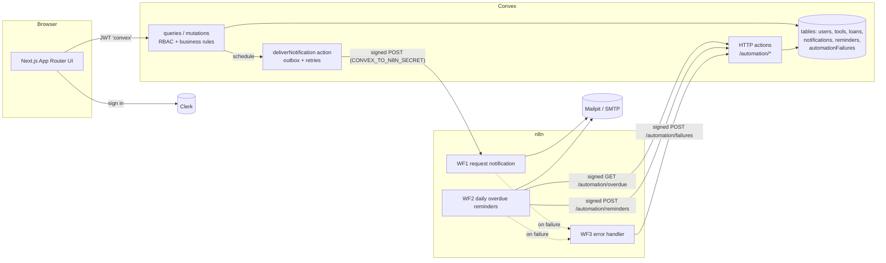

# LendLoop

**Borrow what you need. Lend what you don't.**

LendLoop is a neighborhood tool-lending board. Neighbors list tools they can spare, request each other's tools for a date range, and get notifications and overdue reminders from n8n.

Stack: Next.js 16 (App Router) + TypeScript, Clerk, Convex, n8n, Tailwind CSS 4.

- [Features](#features)
- [Architecture](#architecture)
- [Local setup](#local-setup)
- [Production](#production)
- [Environment variables](#environment-variables)
- [Security and data minimization](#security-and-data-minimization)
- [Testing](#testing)
- [What I'd change for production](#what-id-change-for-production)

## Features

| Area | What you get |
| --- | --- |
| Public page | Name, tagline, a read-only list of tools available now (name and category only), and a **Sign in to lend or borrow** button that opens Clerk |
| All tools | Every listing with an availability pill (available / on loan until X / overdue) and a category filter. You can request dates from any card |
| My listings | Create, edit and delete your own tools (name, category, condition, short description) |
| My requests | What you asked to borrow, its status, recent automation activity, and cancel |
| Incoming requests | Requests for your tools: approve, decline, mark returned |
| Admin | Automation failures, all loans filtered by status, members with the **Trusted Lender** toggle. You can remove any listing from *All tools* |
| Activity | Every loan shows recent automation events, e.g. "Reminder sent · 2 days ago" or "Owner notified of request · 5 minutes ago" |

### Business rules (enforced in Convex)

- You can't borrow your own tool.
- Ranges are inclusive calendar days. The end can't be before the start, the start can't be in the past, and a loan lasts at most 30 days.
- Approved ranges for the same tool never overlap. A new request that overlaps an approved range is rejected. When a request is approved, overlapping pending requests are declined automatically, and those borrowers are notified.
- Status changes follow a single table in [`convex/lib/transitions.ts`](convex/lib/transitions.ts):

  ```
  requested --owner--> approved --owner--> returned
      |                    |
      |--owner--> declined |--borrower (before start)--> cancelled
      |--borrower--> cancelled
  ```

  Only the owner can mark a loan returned, so a borrower can't close a loan on their own.
- When a listing is deleted, its pending requests are declined, its future bookings are cancelled, and each borrower is notified. An owner can't delete a tool that is out on loan. An admin can, as moderation, and the active loan stays so it can still be returned.

## Architecture



### Code layout

```
app/                    routes: / (public), (app)/tools, listings, requests, incoming, admin
components/             UI primitives (ui/), tools/, loans/, admin/
convex/
  schema.ts             tables and indexes
  users.ts tools.ts loans.ts admin.ts   public functions, each starting with requireUser/requireAdmin
  automation.ts         outbox delivery, overdue query, idempotent write-backs (internal only)
  http.ts               signed endpoints for n8n
  lib/                  auth, transitions, dates, signature, notify (outbox), retire, activity
n8n/
  workflows/*.json      exported workflows (import these)
  code/*.js             source of every Code node, synced into the JSON by `npm run n8n:sync`
  credentials/          the Mailpit SMTP credential (no secret: Mailpit needs no password)
tests/                  vitest + convex-test
docker-compose.yml      n8n + Postgres + Mailpit
```

### Request notifications (WF1)

1. Every mutation that creates a request or changes its status also inserts a `notifications` row in the same transaction. This is a transactional outbox. Each mutation then schedules `automation.deliverNotification`.
2. The action builds a minimal payload `{ eventId, event, toolName, startDate, endDate, recipient: { email, firstName } }`, signs it and POSTs it to the n8n webhook with a 10-second timeout.
3. If delivery fails (network error, timeout, non-2xx), it retries with exponential backoff: 30 s, 1 m, 2 m, 4 m, for 5 attempts in total. After the last attempt the notification is marked `failed` and an `automationFailures` row appears in the admin view. A webhook outage never blocks or rolls back the user's action.
4. In n8n, the workflow runs: Webhook (raw body) → **Verify signature and compose** → **Should notify?** → respond `202` and email the one recipient. A bad or stale signature gets `401`. An `eventId` that was already accepted (Convex retrying after a lost response) gets `200 duplicate` and sends no second email.

Who gets notified: request created or cancelled → the owner. Approved, declined, returned, or listing removed → the borrower.

### Overdue reminders (WF2)

The schedule runs every day at 09:00 (`GENERIC_TIMEZONE`). It works through these steps:

1. Sign and GET `/automation/overdue`. Convex returns approved loans whose end date has passed and that have no reminder marked `sent` today.
2. Make one item per loan, then compose the email and send it. The email node retries 3 times, then continues on error so one bad address doesn't stop the batch.
3. Sign and POST `/automation/reminders` with `{ key: "${loanId}:${YYYY-MM-DD}", loanId, status: "sent" | "failed", detail? }`.

The write-back upserts by key. A retry or a byte-for-byte replay of a `sent` result is a no-op (`duplicate`). A `failed` result can later be upgraded to `sent`, but a `sent` result is never downgraded. Re-running the workflow the same day sends nothing new, because the GET already excludes loans reminded today.

### Failures (WF3)

`LendLoop: error handler` is set as the error workflow of WF1 and WF2. It signs the failure (execution id, workflow, node, message) and POSTs it to `/automation/failures`, which dedupes by execution id. Every HTTP and email node also has its own retries. The admin view lists failures from both sources, n8n executions and Convex deliveries that gave up, and has a *Mark resolved* action.

### Signing spec (both directions)

```
X-LendLoop-Timestamp: <unix seconds>
X-LendLoop-Signature: v1=<hex HMAC-SHA256(secret, "<timestamp>.<raw body>")>
```

- The receiver recomputes the MAC over the **raw body bytes**. Convex uses WebCrypto `crypto.subtle.verify`, which is constant time. n8n uses `crypto.timingSafeEqual`.
- Requests outside ±300 seconds are rejected (`stale`). Inside the window, replays are harmless: WF1 dedupes by `eventId`, the write-backs are idempotent by key, the failure endpoint dedupes by execution id, and the GET is read-only.
- Each direction has its own secret. `CONVEX_TO_N8N_SECRET` signs Convex → n8n, and `N8N_TO_CONVEX_SECRET` signs n8n → Convex. A leak of one doesn't allow forging the other direction.
- Convex returns a generic `401`, and `503` if the secret isn't configured. The reason is logged, never returned.
- One spec, two implementations: [`convex/lib/signature.ts`](convex/lib/signature.ts) and [`n8n/code/signature.js`](n8n/code/signature.js). `tests/signature.test.ts` runs both against a fixed vector and against each other.

## Local setup

Prerequisites: Node 20.9+ and npm. For the full n8n stack you also need Docker with Compose.

```bash
npm install
```

### 1. Convex

```bash
npx convex dev            # first run: pick "local deployment" (or log in for a cloud dev deployment)
```

This writes `.env.local` (`CONVEX_DEPLOYMENT`, `NEXT_PUBLIC_CONVEX_URL`, `NEXT_PUBLIC_CONVEX_SITE_URL`) and keeps running, pushing functions on save. A local deployment serves the client API on `:3210` and HTTP actions on `:3211`.

### 2. Clerk

You can use your own keys or keyless mode.

- **Your own keys:** create an application at <https://dashboard.clerk.com>. Put `NEXT_PUBLIC_CLERK_PUBLISHABLE_KEY` and `CLERK_SECRET_KEY` in `.env.local`.
- **Keyless:** leave both empty. `npm run dev` creates a temporary Clerk app and prints a *claim* link.

Either way, Convex has to accept Clerk's tokens:

1. In Clerk, go to **JWT templates → New → Convex** and keep the name `convex`. LendLoop only needs the `aud`, `name`, `given_name`, `email` and `email_verified` claims, so you can trim the rest. In keyless mode, claim the app first.
2. Copy the issuer (Frontend API URL) and set it on Convex:

```bash
npx convex env set CLERK_JWT_ISSUER_DOMAIN https://<your-app>.clerk.accounts.dev
npx convex env set ADMIN_EMAILS you@example.com      # comma-separated, verified emails only
```

### 3. The app

```bash
npm run dev               # http://localhost:3100
npx convex run seed:demo  # optional: 3 neighbors, 6 tools, an active, an overdue and a pending loan
```

Demo neighbors have no Clerk login. Sign up yourself and borrow from them. In a Clerk development instance, any `name+clerk_test@example.com` address verifies with the code `424242`.

### 4. n8n, Postgres and Mailpit

```bash
cp n8n/.env.example n8n/.env          # fill in: openssl rand -hex 32 for each secret
docker compose --env-file n8n/.env up -d
```

- n8n editor: <http://localhost:5678>. Create the owner account on first visit.
- Mailpit inbox: <http://localhost:8025>. All notification and reminder emails land here.
- The one-shot `n8n-import` service imports the Mailpit credential and the three workflows, then publishes them.

Give Convex the same secrets and the webhook URL:

```bash
npx convex env set CONVEX_TO_N8N_SECRET <same as n8n/.env>
npx convex env set N8N_TO_CONVEX_SECRET <same as n8n/.env>
npx convex env set N8N_WEBHOOK_URL http://localhost:5678/webhook/lendloop/request-events
```

How the two sides reach each other depends on where Convex runs:

- **Convex local deployment** (recommended for review): no tunnel is needed. The Convex backend runs on your host and reaches n8n at `localhost:5678`. n8n reaches Convex at `CONVEX_SITE_URL=http://host.docker.internal:3211`.
- **Convex cloud:** set `CONVEX_SITE_URL=https://<deployment>.convex.site` in `n8n/.env`. The cloud can't reach your laptop, so expose n8n with a tunnel (for example `cloudflared tunnel --url http://localhost:5678`) and set `N8N_WEBHOOK_URL=https://<tunnel>/webhook/lendloop/request-events`. Also set `N8N_PUBLIC_URL` to the tunnel URL.

To run the reminder workflow now, open *LendLoop: daily overdue reminders* in n8n and click **Execute workflow**. With the seed data, this sends one reminder for the overdue circular saw. A second run sends nothing.

### Editing workflows

Code node JavaScript lives in `n8n/code/`. After changing it, run `npm run n8n:sync` to write it into the workflow JSON. A test fails if the two drift. If you change workflows in the n8n editor, export them with `n8n export:workflow --id=<id> --pretty`, copy any Code node changes back into `n8n/code/`, and check that nothing secret was added (`npm run check:secrets`).

## Production

<https://lendloop.ahmedrameezaka.com> runs on one small VPS. Everything is self-hosted there.

| Piece | Where | Bound to | Public path |
| --- | --- | --- | --- |
| Next.js app | systemd `lendloop.service`, `/var/www/lendloop.ahmedrameezaka.com` | `[::1]:3100` | `/` |
| Convex backend | Docker Compose project `lendloop-stack`, `/opt/lendloop-stack` ([`deploy/docker-compose.prod.yml`](deploy/docker-compose.prod.yml)) | `127.0.0.1:3210` | `/convex/` (prefix stripped by nginx) |
| Convex HTTP actions | same container, port 3211 | Docker network only | none |
| n8n (SQLite) | same compose project | `127.0.0.1:5678` | none |

Why it looks like this:

- **One domain, no extra DNS.** The Convex client keeps the path of its URL, so `NEXT_PUBLIC_CONVEX_URL=https://lendloop.ahmedrameezaka.com/convex` works for queries, mutations and the websocket. nginx proxies `/convex/` to the backend.
- **n8n is never public.** Convex calls WF1 at `http://n8n:5678/webhook/...` and n8n calls Convex at `http://convex:3211`, both over the compose network. The signatures still apply. To use the n8n editor, open a tunnel with `ssh -L 5678:127.0.0.1:5678 <vps>` and browse to <http://localhost:5678>. The first visit asks you to create the owner account.
- **Lean on memory.** There's no Convex dashboard container and no n8n Postgres. Containers have memory limits: Convex idles around 75 MiB and n8n around 380 MiB.
- **The app binds to `localhost`, not `127.0.0.1`.** Clerk's middleware rewrites to `http(s)://localhost:3100`. Next proxies any rewrite whose host differs from the one it was started with, and that proxy fails with a 500.
- **Clerk** uses the development instance on the production domain (with the dev badge). Swapping to a production instance means new keys in `/etc/lendloop.env` and a new `CLERK_JWT_ISSUER_DOMAIN` on Convex.

Secrets live only on the server, in root-only files:

- `/etc/lendloop.env` holds the Next.js variables ([template](deploy/lendloop.env.example)).
- `/opt/lendloop-stack/.env` holds the Convex instance secret and admin key, the n8n encryption key and both signing secrets ([template](deploy/stack.env.example)).
- The SMTP login is the n8n credential `lendloopMailpit1`. It is seeded from `/opt/lendloop-stack/smtp-credential.json` ([template](deploy/smtp-credential.example.json)). Until real values are in it, emails fail, and each failure shows up under *Admin → Automation failures*.

**Deploys.** A push to `main` runs `.github/workflows/deploy-vps.yml`. It calls `scripts/server-update.sh` on the VPS, which resets to `origin/main` and runs `scripts/rebuild.sh`. That script runs `npm ci` when the lockfile changed, then `npx convex deploy` to the self-hosted backend through [`scripts/convex-prod.sh`](scripts/convex-prod.sh), then `next build`, then restarts the service. The Docker stack is not touched.

**Common tasks** (on the VPS, as root):

```bash
bash /var/www/lendloop.ahmedrameezaka.com/scripts/convex-prod.sh env list        # also: env set, run, logs, data
cd /opt/lendloop-stack && docker compose ps && docker stats --no-stream

# Re-import the workflows or the SMTP credential (edit smtp-credential.json first):
cd /opt/lendloop-stack && docker compose stop n8n && docker compose run --rm n8n-seed && docker compose up -d n8n

# Update Convex or n8n: change the pinned image in deploy/docker-compose.prod.yml,
# copy it to /opt/lendloop-stack/docker-compose.yml, then:
cd /opt/lendloop-stack && docker compose pull && docker compose up -d
```

## Environment variables

| Variable | Where | Purpose |
| --- | --- | --- |
| `CONVEX_DEPLOYMENT`, `NEXT_PUBLIC_CONVEX_URL`, `NEXT_PUBLIC_CONVEX_SITE_URL` | `.env.local` | Written by `npx convex dev` |
| `NEXT_PUBLIC_CLERK_PUBLISHABLE_KEY`, `CLERK_SECRET_KEY` | `.env.local` | Clerk keys. Leave empty for keyless dev |
| `CLERK_JWT_ISSUER_DOMAIN` | Convex env | Issuer of the `convex` JWT template |
| `ADMIN_EMAILS` | Convex env | Comma-separated emails that get the admin role, if verified |
| `N8N_WEBHOOK_URL` | Convex env | WF1 production webhook URL |
| `CONVEX_TO_N8N_SECRET` | Convex env + `n8n/.env` | Signs Convex → n8n |
| `N8N_TO_CONVEX_SECRET` | Convex env + `n8n/.env` | Signs n8n → Convex |
| `CONVEX_SITE_URL` | `n8n/.env` | Convex HTTP actions base URL, as seen from n8n |
| `N8N_ENCRYPTION_KEY`, `N8N_DB_PASSWORD` | `n8n/.env` | n8n credential encryption and its Postgres password |
| `LENDLOOP_APP_URL`, `LENDLOOP_MAIL_FROM`, `GENERIC_TIMEZONE`, `N8N_PUBLIC_URL` | `n8n/.env` | Links in emails, sender, schedule timezone, public n8n URL |

Templates: [`.env.example`](.env.example) for Next.js and [`n8n/.env.example`](n8n/.env.example) for the stack. The n8n file is separate so the Next.js process never loads n8n's secrets.

## Security and data minimization

**Authorization lives in Convex.**

- Every public function starts with `requireUser` or `requireAdmin`. These resolve the verified Clerk identity (`tokenIdentifier`) to a stored user.
- Roles are read from the database, never from client input. Ownership is checked against the stored record.
- The UI only hides actions it knows will fail. `proxy.ts` (Clerk middleware) gates navigation, but it is not the security boundary.
- Tests call every mutation as the wrong user.

**Admin is least privilege.**

- Admins can moderate (remove listings, Trusted Lender), see all loans and see member emails.
- Admins can't approve, decline or return loans on behalf of others.
- Admin status comes only from `ADMIN_EMAILS` plus a verified email claim. Signing up with someone else's unverified address grants nothing.

**Validation:**

- Convex argument validators check every argument.
- Strings are trimmed and length-bounded, dates are checked as real calendar days, and HTTP bodies are size-capped and type-checked.
- Errors are `ConvexError({ code, message })`. The UI shows the message, never a stack trace.

**Data minimization:**

- **Public page:** the query returns an explicit `{ id, name, category }` projection, so owner data can't leak even if the table gains fields. A test checks this.
- **Signed-in views:** you see other members only as "First L." plus their Trusted Lender badge. Emails reach only their owner, admins, and n8n.
- **n8n payloads:** they carry only what one message needs: recipient email and first name, tool name, dates and event type. Descriptions, other members and ids beyond `eventId`/`loanId` are never sent.
- **Clerk JWT template:** it only needs five claims.
- **n8n execution history:** successful executions are not stored (`saveDataSuccessExecution: none`) because they contain email addresses. Failed ones are kept for debugging.

**Secrets:**

- Secrets live only in Convex environment variables and in n8n's environment. The SMTP login is an n8n credential.
- The exported workflow JSON holds no secret. A test asserts there is no secret or credential data, and `npm run check:secrets` greps every tracked file.
- Each direction has its own secret, compared in constant time, with a replay window.

**Transport and headers:**

- The app sends `X-Frame-Options: DENY`, `nosniff`, a strict referrer policy and a restrictive permissions policy.
- The `x-powered-by` header is off.
- n8n and Mailpit bind to `127.0.0.1` only.

**Known trade-off:** the Code nodes read the two signing secrets via `$env`, which needs `N8N_BLOCK_ENV_ACCESS_IN_NODE=false`. That flag lets any workflow editor read the n8n process environment. That's acceptable for a single-admin local stack. In production, see below.

## Testing

```bash
npm test          # vitest + convex-test
npm run lint      # ESLint (Next + TypeScript rules), including the n8n Code node sources
npm run typecheck
npm run build
npm run check:secrets
```

| File | Covers |
| --- | --- |
| `tests/signature.test.ts` | Fixed HMAC vector; the Convex and n8n implementations agree in both directions; tampered body, wrong secret, replay window edges (past and future), malformed and unconfigured input |
| `tests/rbac.test.ts` | Signed-out callers, admin bootstrap needs a verified email, public projection, own-listing edits only, admin-only functions, self-borrowing, date rules, overlap, auto-decline, party checks, every invalid transition, one notification per change |
| `tests/http.test.ts` | Unsigned, stale and wrong-secret requests get 401; 503 when not configured; minimal overdue payload; idempotent write-back under retries and replays; failed → sent upgrade; forged keys rejected; failure reports deduped |
| `tests/notify.test.ts` | The outbound payload verifies with the n8n code and holds only the expected fields; retries with backoff, then a visible failure |
| `tests/n8n-workflows.test.ts` | Workflow JSON matches `n8n/code`, error workflow set, retries on every network node, no secrets or credential data, raw-body webhook |

The workflows were also verified end to end with n8n 2.43.8 against a local Convex deployment. That run covered:

- valid, stale, tampered and replayed webhooks (202 / 401 / 401 / 200 duplicate);
- a real request → n8n → email;
- the overdue run writing back `created`, and a second run sending nothing;
- an SMTP outage reaching the admin view through the error workflow.

## What I'd change for production

- **Secrets:**
  - Replace `$env` access in n8n with n8n external secrets (Vault or AWS Secrets Manager), or a small custom credential type for HMAC signing, and keep `N8N_BLOCK_ENV_ACCESS_IN_NODE` at its default.
  - Rotate secrets with a two-key overlap: accept the old and new key for one deploy.
- **n8n hosting:**
  - Run n8n in queue mode (main + workers + Redis) behind TLS, with external task runners, SSO, and the editor off the public internet.
  - Expose only the webhook path, and add an IP allow-list for Convex's egress.
- **Delivery:**
  - Keep the outbox, and add a periodic sweeper (Convex cron) that re-queues `pending` notifications older than N minutes, in case a scheduled action is lost.
  - Add a dead-letter view with a *retry* button.
  - Persist WF1's seen `eventId`s in a durable store (Redis or Postgres) instead of workflow static data.
- **Email:** use a real provider (SES or Postmark) with templates and suppression lists, unsubscribe links for reminders, and per-user notification preferences.
- **Time zones:** dates are UTC calendar days today. Store each user's time zone, and send reminders in the borrower's morning.
- **Scale:**
  - Paginate the list queries (`usePaginatedQuery`), and denormalize current availability onto `tools` to avoid per-tool loan lookups.
  - Batch the overdue endpoint with a cursor.
  - Add rate limits on request creation (for example `@convex-dev/rate-limiter`).
- **Identity:**
  - Manage roles in Clerk organizations or `publicMetadata`, synced through a svix-verified Clerk webhook, instead of an env list.
  - Add an audit log of admin actions.
- **Observability:**
  - Structured logs from Convex and n8n into Datadog or Sentry, with an alert when `automationFailures` gains rows or WF2 doesn't run by 09:15.
  - Track the webhook's p95 latency and error rate.
- **Abuse and safety:** content moderation on listings, reporting, deposit and damage handling, and borrower ratings that feed Trusted Lender instead of a manual toggle.
- **CI/CD:** GitHub Actions for lint, typecheck, tests, the secret scan (gitleaks) and a workflow-JSON drift check; preview deployments; and `npx convex deploy` gated on tests.
